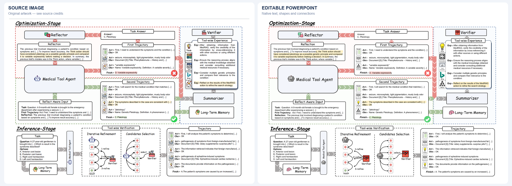
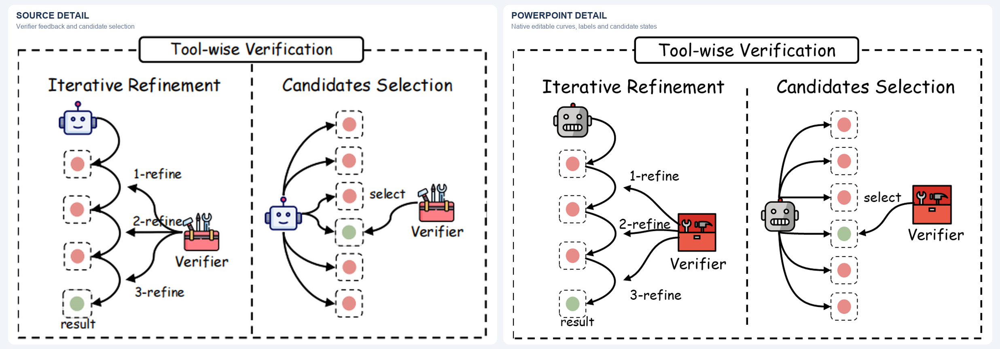

<div align="center">

# Image2EditablePPT

### Turn an image into a PowerPoint you can keep editing.

A Codex skill for rebuilding diagrams, screenshots and AI-generated layouts with native text, shapes and connections — plus independently replaceable visual assets.

[中文](README.zh-CN.md) · [Install](docs/INSTALL.md) · [Examples](examples/README.md)

</div>


*Source: [HKUDS / RAG-Anything](examples/rag-anything/SOURCE.md). Left: source image. Right: exported PowerPoint render.*  
**[Download the editable PPTX](examples/rag-anything/editable.pptx)**

## Use it

Download this repository and ask Codex:

> Install the local skill in `skills/image-to-editable-pptx`. Preserve my existing version if one is installed.

Then attach an image and say:

> Use $image-to-editable-pptx to rebuild this image as an editable PowerPoint. Keep the layout, wording and arrow meanings. Prioritize icons I explicitly supply or select; otherwise find semantically suitable, stylistically consistent icons on real asset websites. Save a new PPTX.

Add a preferred font, a style reference or an icon website when you have one. [Manual installation and requirements →](docs/INSTALL.md)

## What you get

- **Editable content:** change labels, numbers, colors and geometric shapes in PowerPoint.
- **Meaningful structure:** modules, branches and feedback loops are reconstructed as native objects.
- **Suitable icons:** prioritize your explicit icon choices; otherwise use real asset websites to find a coherent set, with source records.
- **Rendered review:** inspect the exported deck, repair observed layout defects and check a representative edit.

An icon appearing in the source image is not automatically a request to retain it. Verified website assets can be reused. Brand marks use official assets or originals where available; photos, experimental results and data imagery retain their real content. Clear originals are preferred, faithful reconstruction needs reliable information, and complete crops or screenshots are valid fallbacks when better sources are unavailable.

The workflow is **read the image → map its elements → obtain assets → rebuild the PPTX → render and check**. It preserves content, layout, visual hierarchy and overall style while selecting suitable icons; broader redesign requires your instruction.

## Examples

| Case | What it demonstrates | Open |
| --- | --- | --- |
| **RAG-Anything** | Dense architecture, graph relationships, nested regions and mixed icon styles | [Before / after](examples/rag-anything/comparison.png) · [PPTX](examples/rag-anything/editable.pptx) · [Source](examples/rag-anything/SOURCE.md) |
| **Semantic communication** | Rich icons, paragraph text, branches and environmental feedback | [Before / after](examples/semantic-communication/comparison.png) · [PPTX](examples/semantic-communication/editable.pptx) · [Source](examples/semantic-communication/SOURCE.md) |
| **ReflecTool** | Dense text, highlights, wide arrow bands and curved branches | [Before / after](examples/reflectool/comparison.png) · [PPTX](examples/reflectool/editable.pptx) · [Source](examples/reflectool/SOURCE.md) |
| **GoAgentNet** | Layered multi-agent architecture; local reconstruction available for review | [Original source and availability](examples/goagentnet/SOURCE.md) |

### Semantic communication

Rich icons, paragraph text and feedback links, rebuilt as editable structure.


*Source: Tang et al., Retrieval-augmented Generation for GenAI-enabled Semantic Communications. [Credits and changes](examples/semantic-communication/SOURCE.md).*  
**[Download the editable PPTX](examples/semantic-communication/editable.pptx)**

### ReflecTool

Dense text, highlights, wide arrow bands and curved branches, rebuilt as editable elements.



*Source: Liao et al., [ReflecTool: Towards Reflection-Aware Tool-Augmented Clinical Agents](https://aclanthology.org/2025.acl-long.663/), ACL 2025, Figure 2. [Credits and changes](examples/reflectool/SOURCE.md).*  
**[Download the editable PPTX](examples/reflectool/editable.pptx)**

<details>
<summary>Close-up: verification loops and candidate branches</summary>



Iterative refinement and candidate selection. Left: source image. Right: exported PowerPoint render.

</details>

## Scope and limitations

This is an **agent workflow skill**, not a standalone OCR converter. It needs an image-capable agent, a PPTX authoring tool and a renderer. It does not bundle a model, install fonts or provide a hosted service.

Text and simple geometry are native. Complex icons, photographs and scientific imagery can remain independent pictures: movable and replaceable, not necessarily editable stroke by stroke. Some freeform paths need manual adjustment when modules move. Do not infer that every arrow is attached.

Reconstruction quality depends on source clarity, available tools and model capability. The examples are curated worked cases, not a model benchmark, a pixel-perfect guarantee or a claim of one-click conversion. Unreadable source content and uncertain chart data are clarified instead of invented.

## For contributors

The skill lives in [`skills/image-to-editable-pptx`](skills/image-to-editable-pptx). Detailed guidance is loaded only when needed. The optional package inspector uses Python's standard library:

```sh
python -m unittest discover -s tests
python skills/image-to-editable-pptx/scripts/inspect_pptx.py --help
```

Structure checks support the visual review; they cannot prove semantic correctness or pixel-level fidelity. [Changes in this package](docs/CHANGES.md)

## Credits and licenses

The skill, helper code and original documentation use the [MIT license](LICENSE). Third-party figures, icons, brand marks and reconstruction derivatives retain their own terms. Each example has a source and modification record; see [THIRD_PARTY_NOTICES.md](THIRD_PARTY_NOTICES.md). No third-party font files are distributed.
