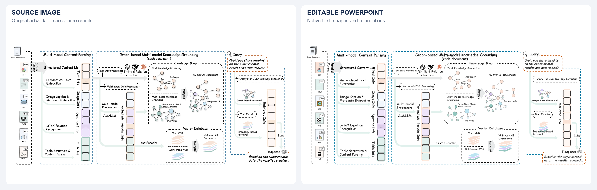
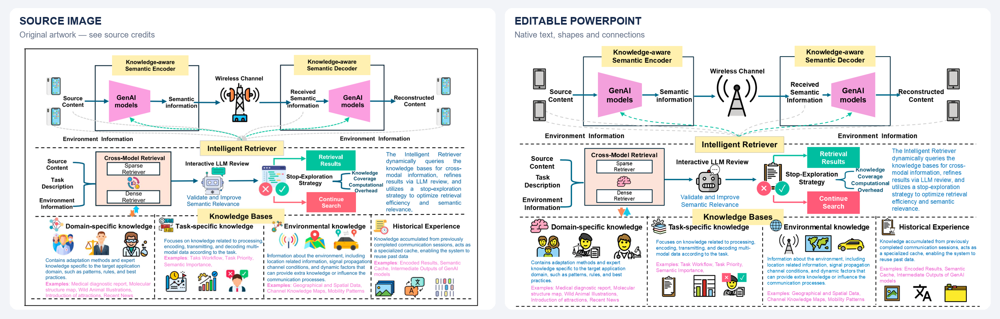

# Image2EditablePPT

### 把图片重建成可以继续修改的 PowerPoint。

面向 Codex 的图片可编辑化 Skill：文字、形状和连接关系用原生对象重建，复杂图标作为独立图片保留或替换。

[English](README.md) · [安装](docs/INSTALL.md) · [案例](examples/README.md)

*原图来自 [HKUDS / RAG-Anything](examples/rag-anything/SOURCE.md)。左为原图，右为 PowerPoint 导出效果。*  
**[下载可编辑 PPTX](examples/rag-anything/editable.pptx)**

## 安装与使用

下载仓库后，可以直接告诉 Codex：

> 请安装本地 `skills/image-to-editable-pptx` 技能。如果已有同名版本，先保留原版。

附上图片，再输入：

> 请用 $image-to-editable-pptx 把这张图重建成可编辑 PPT。保留布局、文字和箭头含义，图标匹配参考风格，必要时去真实网站寻找素材，另存一个新的 PPTX。

也可以补充字体、风格样例或偏好的图标网站。[手动安装与环境要求 →](docs/INSTALL.md)

## 能做什么

- **文字与结构可编辑**：修改内容、字号、颜色、图形和流程关系。
- **模块有组织**：按实际编辑需要分组，不把整页图片切碎冒充可编辑。
- **图标有依据**：复用合适的原素材，或从真实网站寻找替代品，记录来源。
- **交付前看成品**：渲染 PPTX，检查实际效果，并抽查文字、模块与图标的编辑行为。

流程是：**理解图片 → 拆分元素 → 准备素材 → 重建 PPT → 渲染检查**。默认保持原图，不擅自改内容或设计。

## 案例

| 案例 | 展示重点 | 查看 |
| --- | --- | --- |
| **RAG-Anything** | 密集架构、图节点与边、多层区域、混合图标 | [对照图](examples/rag-anything/comparison.png) · [PPTX](examples/rag-anything/editable.pptx) · [来源](examples/rag-anything/SOURCE.md) |
| **知识感知通信** | 多种图标、较多文字、流程分支和回流 | [对照图](examples/semantic-communication/comparison.png) · [PPTX](examples/semantic-communication/editable.pptx) · [来源](examples/semantic-communication/SOURCE.md) |
| **GoAgentNet** | 多层多智能体架构；重建产物在独立本地审核包 | [原图来源与可用范围](examples/goagentnet/SOURCE.md) |

展开知识感知通信对照图

原图：Tang 等，*Retrieval-augmented Generation for GenAI-enabled Semantic Communications*。[署名与修改说明](examples/semantic-communication/SOURCE.md)

## 适用边界

这是依靠智能体执行的工作流程 Skill，需要宿主提供图片理解、PPTX 构建和渲染工具；不是独立转换软件，也不捆绑模型、字体或云服务。

文字与简单结构尽量原生重建。复杂图标、照片和科研图像可以保留为独立图片，能够移动和替换，不代表每条笔画都能编辑。部分自由路径需要随布局手动调整，并非所有箭头都会自动跟随。

效果取决于原图清晰度、模型能力和可用工具。展示案例是经过检查的实际案例，不是模型评测，也不承诺一键、像素级一致。看不清的内容和无法确认的图表数据会先澄清，不自行补造。

## 维护与许可

技能位于 [`skills/image-to-editable-pptx`](skills/image-to-editable-pptx)，参考文件按需读取。可选检查脚本只用 Python 标准库；测试运行方式见 [English README](README.md#for-contributors)。[本次改进](docs/CHANGES.md)

Skill、辅助代码和原创文档采用 [MIT](LICENSE)。第三方图片、图标、商标和重建衍生内容保留各自条款，详见 [来源与许可](THIRD_PARTY_NOTICES.md)。不附带第三方字体文件。
